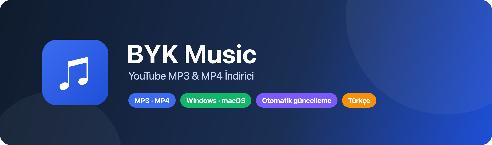
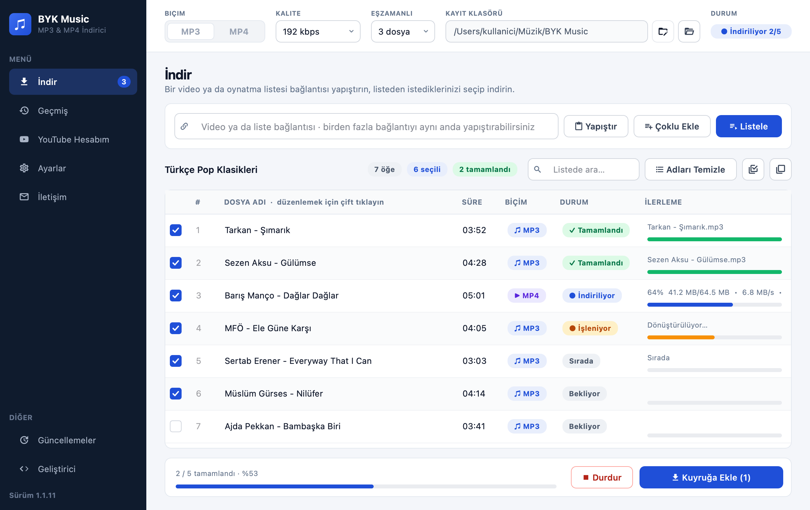
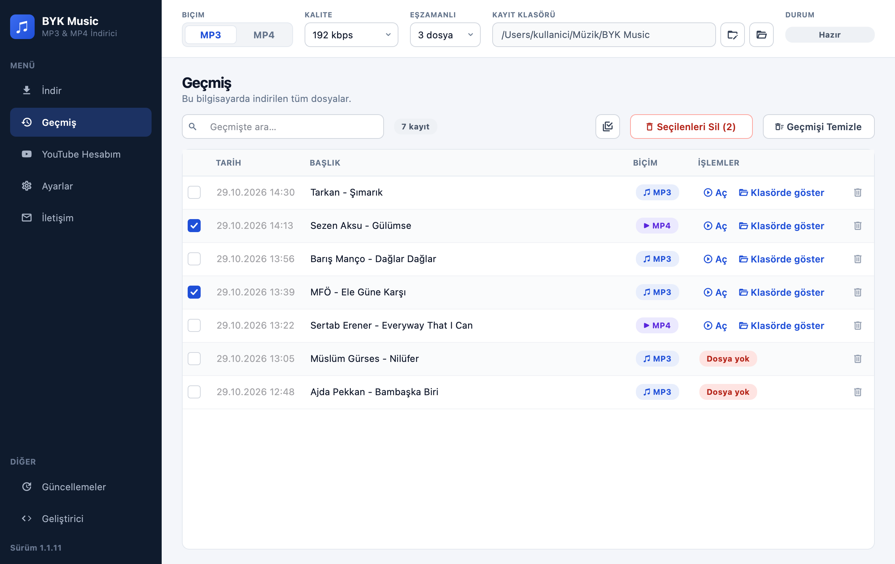
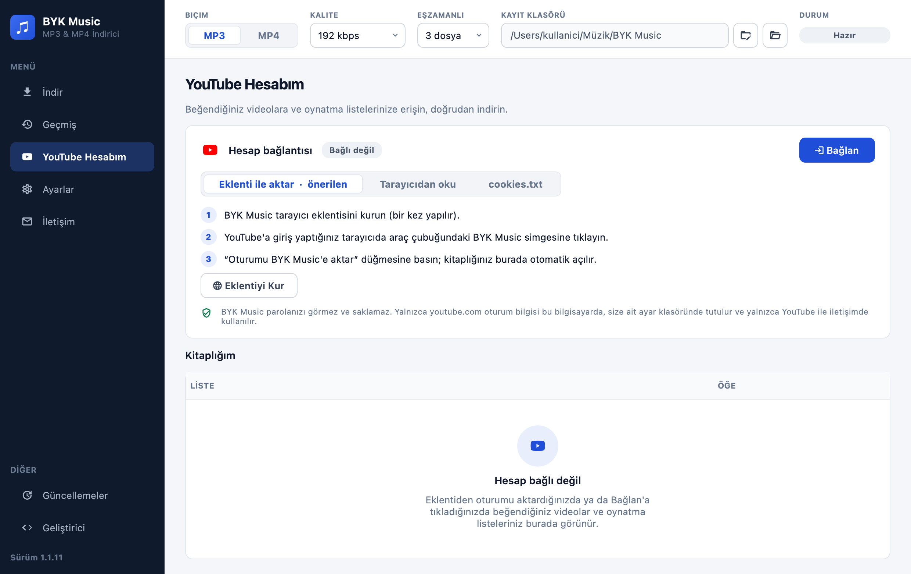
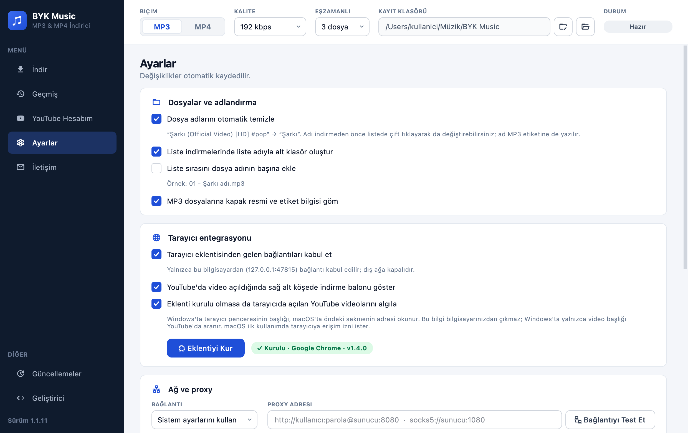
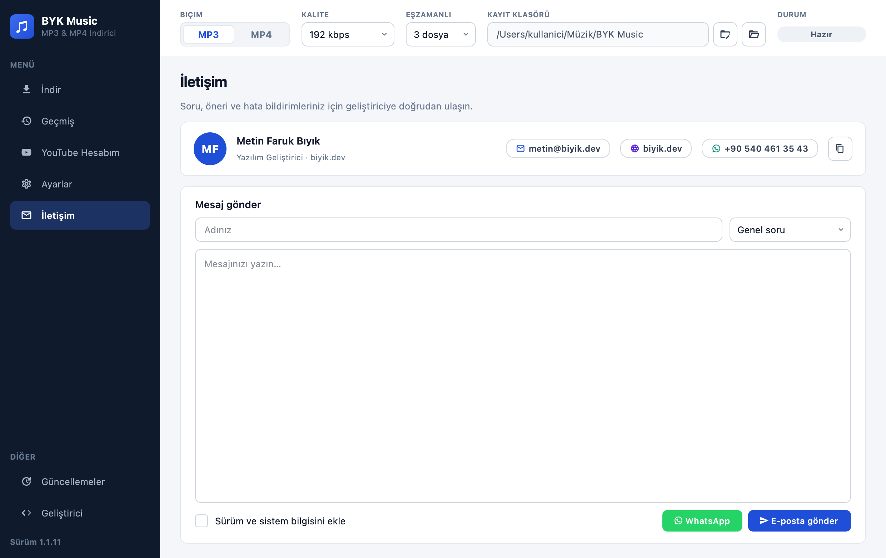
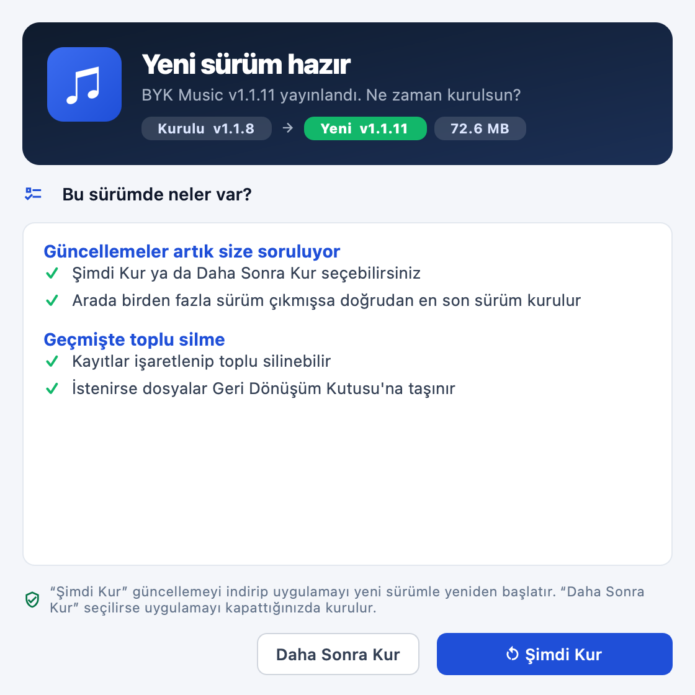
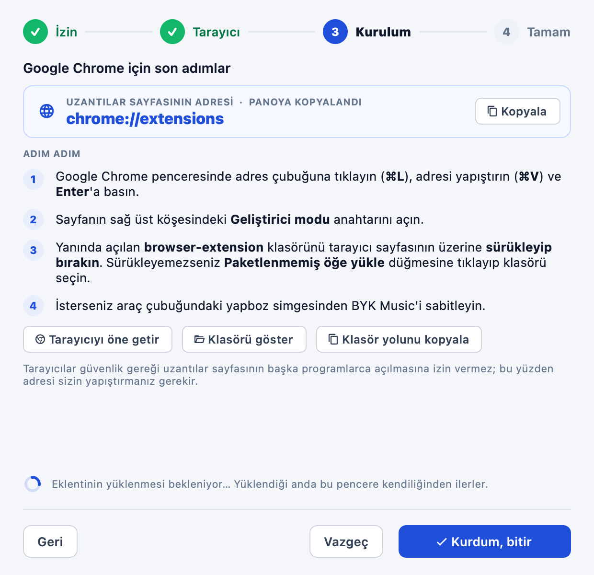
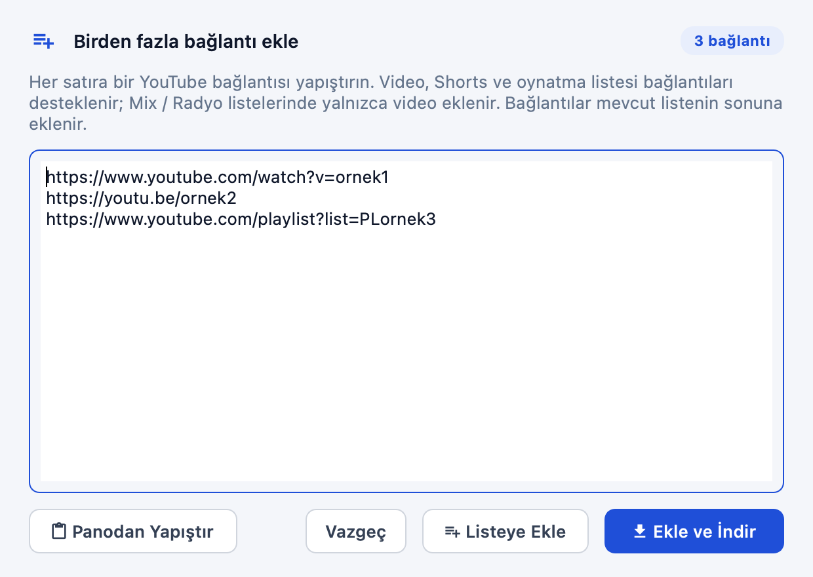
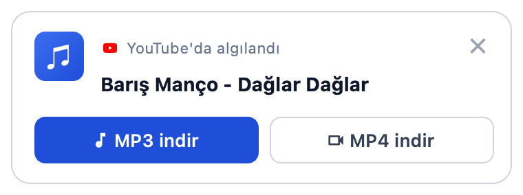

<p align="center">
  
</p>

<p align="center">
  <a href="https://github.com/metinfarukbiyik/byk-music/releases/latest"></a>
  <a href="https://github.com/metinfarukbiyik/byk-music/actions/workflows/build.yml"></a>
  <a href="https://github.com/metinfarukbiyik/byk-music/releases"></a>
  <a href="https://github.com/metinfarukbiyik/byk-music/releases/latest"></a>
</p>

<p align="center">
  
  
  
  
  
  
</p>

<p align="center">
  YouTube'daki müzik ve videoları <b>tek tıkla MP3 ya da MP4</b> olarak indirin.<br>
  Oynatma listelerinden istediğiniz parçaları seçin, birden fazla bağlantıyı aynı anda indirin.
</p>

<p align="center">
  <a href="https://github.com/metinfarukbiyik/byk-music/releases/latest/download/BYKMusic-Windows-Setup.exe"></a>
  &nbsp;
  <a href="https://github.com/metinfarukbiyik/byk-music/releases/latest/download/BYKMusic-macOS.dmg"></a>
</p>

---

<p align="center">
  
</p>

## ✨ Neler yapabilir?

| | Özellik | Açıklama |
|:-:|---|---|
| 🎵 | **MP3 ve MP4** | 128–320 kbps MP3 (kapak resmi ve sanatçı / başlık etiketiyle) ya da 360p–4K MP4 |
| 📋 | **Oynatma listeleri** | Listeyi görün, yalnızca istediğiniz parçaları seçip indirin |
| 🔗 | **Çoklu bağlantı** | Birden fazla bağlantıyı tek seferde yapıştırın ya da *Çoklu Ekle* penceresini kullanın |
| ⚡ | **Eşzamanlı indirme** | Aynı anda 1–5 dosya; indirme sürerken yeni bağlantılar kuyruğa eklenir |
| ✏️ | **Temiz dosya adları** | “(Official Video)”, “[HD]”, “#etiket” gibi ekler otomatik silinir; adı indirmeden önce değiştirebilirsiniz |
| 🫧 | **İndirme balonu** | Tarayıcıda YouTube videosu açtığınızda sağ altta *MP3 / MP4 indir* balonu çıkar |
| 🧩 | **Tarayıcı eklentisi** | Videonun altına indirme düğmesi ekler; YouTube oturumunuzu tek tıkla aktarır |
| ▶️ | **YouTube Hesabım** | Beğendiğiniz videolar, *Daha sonra izle* ve oynatma listeleriniz uygulamada |
| 🕘 | **Geçmiş** | Arama, MP3 / MP4 rozetleri, tek tek ya da toplu silme, geri alma |
| 🔄 | **Güncellemeler** | Yeni sürüm çıkınca size sorulur: *Şimdi Kur* ya da *Daha Sonra Kur*; her zaman doğrudan en son sürüm kurulur |
| 🌐 | **Proxy** | Sistem ayarı, doğrudan bağlantı ya da HTTP / HTTPS / SOCKS5 proxy |
| 💬 | **İletişim** | Uygulama içinden e-posta ya da WhatsApp ile geliştiriciye ulaşın |

> [!TIP]
> Akıllı bağlantı algılama sayesinde YouTube'un otomatik **Mix / Radyo** listeleri (`&list=RD…`) yerine yalnızca açtığınız video eklenir. Gerçek bir liste içeren video bağlantılarında *yalnızca video / tüm liste* seçimi sunulur.

## 🖼️ Ekran görüntüleri

<table>
  <tr>
    <td width="50%"><p align="center"><b>Geçmiş</b> · toplu silme ve biçim rozetleri</p></td>
    <td width="50%"><p align="center"><b>YouTube Hesabım</b> · beğenilenler ve listeler</p></td>
  </tr>
  <tr>
    <td><p align="center"><b>Ayarlar</b> · adlandırma, tarayıcı, proxy</p></td>
    <td><p align="center"><b>İletişim</b> · e-posta ve WhatsApp</p></td>
  </tr>
  <tr>
    <td><p align="center"><b>Güncelleme</b> · Şimdi Kur / Daha Sonra Kur</p></td>
    <td><p align="center"><b>Eklenti sihirbazı</b> · adım adım kurulum</p></td>
  </tr>
  <tr>
    <td><p align="center"><b>Çoklu bağlantı</b> · tek seferde ekleme</p></td>
    <td><p align="center"><b>İndirme balonu</b> · YouTube'da algılandığında</p></td>
  </tr>
</table>

## 📥 Kurulum

### 🪟 Windows

1. **[BYKMusic-Windows-Setup.exe](https://github.com/metinfarukbiyik/byk-music/releases/latest/download/BYKMusic-Windows-Setup.exe)** dosyasını indirip çalıştırın.
2. Kurulum `C:\Program Files\BYK Music` klasörüne yapılır; Başlat menüsüne kısayol eklenir.
3. Uygulama *Denetim Masası → Programlar* bölümünde yayıncı **biyik.dev** olarak görünür ve oradan kaldırılabilir.

> [!NOTE]
> Uygulama henüz bir kod imzalama sertifikasıyla imzalanmadığı için Windows ilk açılışta **“Windows bilgisayarınızı korudu”** uyarısı gösterebilir. **Ek bilgi → Yine de çalıştır** ile devam edebilirsiniz. Kurulum, Program Files'a yapıldığı için yönetici onayı ister.

### 🍎 macOS

1. **[BYKMusic-macOS.dmg](https://github.com/metinfarukbiyik/byk-music/releases/latest/download/BYKMusic-macOS.dmg)** dosyasını açın.
2. **BYK Music** simgesini *Applications* (Uygulamalar) klasörüne sürükleyin.
3. İlk açılışta uygulamaya **sağ tıklayıp → Aç** deyin.

> [!IMPORTANT]
> macOS sürümü **Apple Silicon (M1 ve sonrası)** Mac'ler içindir.

## 🚀 Nasıl kullanılır?

1. YouTube'da bir video ya da oynatma listesinin bağlantısını kopyalayın.
2. Üst çubuktan **biçim** (MP3 / MP4), **kalite** ve **kayıt klasörünü** seçin.
3. Bağlantıyı kutuya yapıştırıp **Listele**'ye tıklayın.
4. İndirmek istediklerinizi işaretleyin; isterseniz dosya adına çift tıklayıp değiştirin.
5. **Seçilenleri İndir**'e tıklayın. İlerlemeyi her satırda ve alt çubukta izleyebilirsiniz.

> [!TIP]
> Bağlantı kopyalamakla uğraşmak istemiyor musunuz? YouTube'da bir video açın: **sağ altta indirme balonu** belirir. *MP3 indir* ya da *MP4 indir*'e tıklamanız yeterli.

## 🧩 Tarayıcı eklentisi

Eklenti; videonun altına **♫ MP3 | MP4** düğmesi ekler, açtığınız videoyu anında algılar ve YouTube oturumunuzu tek tıkla uygulamaya aktarır. Chrome, Edge, Brave, Opera, Vivaldi ve Firefox desteklenir.

**Kurulum:** Uygulamada **Ayarlar → Tarayıcı entegrasyonu → Eklentiyi Kur**. Sihirbaz tarayıcınızı bulur, eklenti klasörünü açar, uzantılar sayfasının adresini panoya kopyalar ve kurulumu kendiliğinden algılar. Eklenti, uygulama güncellendiğinde kendini otomatik günceller.

## ❓ Sık sorulan sorular

<details>
<summary><b>İndirilen dosyalar nereye kaydediliyor?</b></summary>
<br>
Varsayılan olarak <code>İndirilenler/BYK Music</code> klasörüne. Üst çubuktaki <b>Kayıt klasörü</b> alanından değiştirebilirsiniz. Oynatma listeleri isterseniz liste adıyla ayrı bir alt klasöre kaydedilir.
</details>

<details>
<summary><b>Güncellemeler nasıl geliyor?</b></summary>
<br>
Uygulama açılışta ve açıkken yarım saatte bir yeni sürümü denetler. Yeni sürüm bulunduğunda size sorulur: <b>Şimdi Kur</b> uygulamayı yeni sürümle yeniden başlatır, <b>Daha Sonra Kur</b> uygulamayı kapattığınızda kurar. Arada birden fazla sürüm çıktıysa doğrudan en son sürüm kurulur; ayarlarınız ve geçmişiniz korunur.
</details>

<details>
<summary><b>YouTube hesabımı bağlamak güvenli mi?</b></summary>
<br>
BYK Music parolanızı görmez ve saklamaz. Eklenti yalnızca <code>youtube.com</code> oturum bilgisini aktarır; bu bilgi yalnızca bu bilgisayarda, size ait ayar klasöründe tutulur ve yalnızca YouTube ile iletişimde kullanılır. <i>Bağlantıyı Kes</i> dediğinizde silinir.
</details>

<details>
<summary><b>İndirme “uygun biçim bulunamadı” hatası veriyor.</b></summary>
<br>
Uygulama önce farklı yöntemlerle kendiliğinden yeniden dener. Hata sürerse <b>YouTube Hesabım</b> sayfasından bağlantıyı kesip yeniden deneyin ya da hata metnini <b>İletişim</b> sayfasından geliştiriciye gönderin.
</details>

<details>
<summary><b>Silinen geçmiş kayıtları geri alınabilir mi?</b></summary>
<br>
Yalnızca kayıt sildiyseniz bildirimdeki <b>Geri al</b> ile geri getirebilirsiniz. “Dosyaları da sil” seçeneği dosyaları kalıcı silmez, <b>Geri Dönüşüm Kutusu</b>'na (macOS'ta Çöp Kutusu'na) taşır.
</details>

> [!CAUTION]
> Yalnızca indirme hakkına sahip olduğunuz içerikleri indirin. Telif hakkıyla korunan içeriklerin izinsiz çoğaltılması ve paylaşılması yasalara aykırı olabilir.

## 💬 İletişim

<p>
  <a href="mailto:metin@biyik.dev"></a>
  <a href="https://biyik.dev"></a>
  <a href="https://wa.me/905404613543"></a>
</p>

Soru, öneri ve hata bildirimleriniz için uygulamadaki **İletişim** sayfasını da kullanabilirsiniz.

---

<details>
<summary><b>🛠️ Geliştiriciler için</b></summary>

### Çalıştırma

```bash
python -m venv .venv
source .venv/bin/activate        # Windows: .venv\Scripts\activate
pip install -r requirements.txt
python main.py
```

### Sürüm yayınlama

`main` dalına yapılan her gönderim GitHub Actions ile otomatik olarak:

1. Sürüm numarasını belirler (`byk_music/__init__.py` içindeki `ana.ara` + derleme numarası)
2. Windows kurulum programını (Inno Setup) ve macOS uygulamasını derler
3. Commit mesajlarından Türkçe sürüm notu ve `latest.json` güncelleme bilgisini üretir
4. Hepsini yeni bir GitHub Release olarak yayınlar

Yalnızca belgeler (`*.md`, `docs/`) değiştiğinde yeni sürüm yayınlanmaz. `Belgeler:` ile başlayan commit'ler sürüm notlarına eklenmez.

### Ekran görüntüleri

```bash
QT_SCALE_FACTOR=2 python packaging/screenshots.py <sürüm>
```

### Kod imzalama (Windows)

Bir kod imzalama sertifikası alındığında deponun **Settings → Secrets and variables → Actions** bölümüne `WINDOWS_CERT_PFX` (base64) ve `WINDOWS_CERT_PASSWORD` eklenir; uygulama ve kurulum programı otomatik imzalanır.

### Yapı

```
byk_music/
  config.py          uygulama, yayıncı ve geliştirici bilgileri
  core/              indirme motoru (yt-dlp), bağlantılar, geçmiş, güncelleyici, tarayıcı köprüsü
  ui/                ana pencere, açılış ekranı, bildirimler, hesap, iletişim, sihirbazlar
browser-extension/   Chrome / Edge / Firefox eklentisi
packaging/           kurulum programı, sürüm notları, imzalama, simge ve ekran görüntüsü üretimi
docs/                README görselleri
```

</details>

<p align="center">
  <sub>© 2026 <b>Metin Faruk Bıyık</b> · <a href="https://biyik.dev">biyik.dev</a> · Tüm hakları saklıdır.</sub>
</p>
